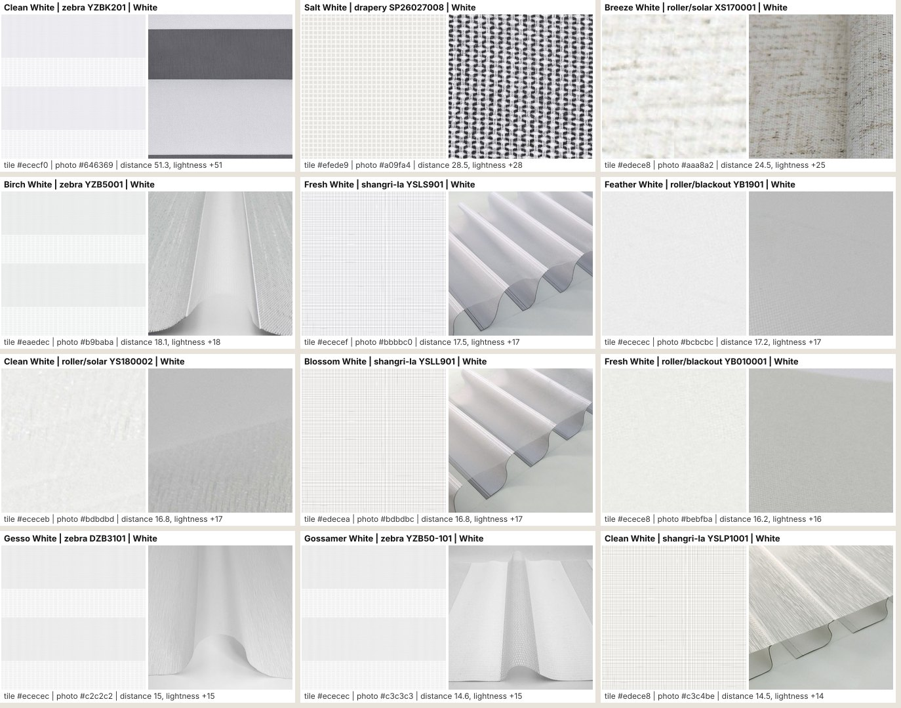
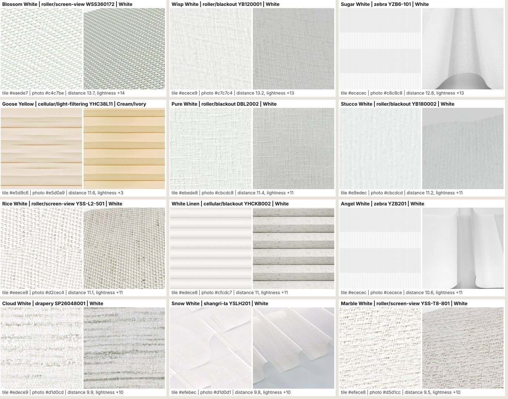
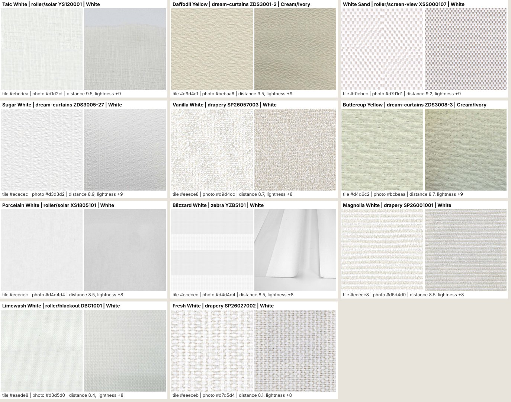

# White and Cream colors to review (after the part 2 moves)

Made by `node scripts/color-family-review.mjs` (read-only). 117 White and Cream/Ivory colors reviewed; **35** have a tile that looks noticeably off from the photo (tile more than 9 color distance from the photo average, or more than 8 lightness apart). In each image the tile (left) is drawn as the site draws it, the photo is on the right. Nothing has been changed.

| Color | Line | Code | Family | Photo average | Tile | Distance | Lightness |
|---|---|---|---|---|---|---|---|
| Clean White | zebra | YZBK201 | White | `#646369` | `#ececf0` | 51.3 | +51 |
| Salt White | drapery | SP26027008 | White | `#a09fa4` | `#efede9` | 28.5 | +28 |
| Breeze White | roller/solar | XS170001 | White | `#aaa8a2` | `#edece8` | 24.5 | +25 |
| Birch White | zebra | YZB5001 | White | `#b9baba` | `#eaedec` | 18.1 | +18 |
| Fresh White | shangri-la | YSLS901 | White | `#bbbbc0` | `#ececef` | 17.5 | +17 |
| Feather White | roller/blackout | YB1901 | White | `#bcbcbc` | `#ececec` | 17.2 | +17 |
| Clean White | roller/solar | YS180002 | White | `#bdbdbd` | `#ececeb` | 16.8 | +17 |
| Blossom White | shangri-la | YSLL901 | White | `#bdbdbc` | `#edecea` | 16.8 | +17 |
| Fresh White | roller/blackout | YB010001 | White | `#bebfba` | `#ecece8` | 16.2 | +16 |
| Gesso White | zebra | DZB3101 | White | `#c2c2c2` | `#ececec` | 15 | +15 |
| Gossamer White | zebra | YZB50-101 | White | `#c3c3c3` | `#ececec` | 14.6 | +15 |
| Clean White | shangri-la | YSLP1001 | White | `#c3c4be` | `#edece8` | 14.5 | +14 |
| Blossom White | roller/screen-view | WSS360172 | White | `#c4c7be` | `#eaede7` | 13.7 | +14 |
| Wisp White | roller/blackout | YB120001 | White | `#c7c7c4` | `#ecece9` | 13.2 | +13 |
| Sugar White | zebra | YZB6-101 | White | `#c8c8c8` | `#ececec` | 12.8 | +13 |
| Goose Yellow | cellular/light-filtering | YHC38L11 | Cream/Ivory | `#e5d0a9` | `#e5d9c6` | 11.6 | +3 |
| Pure White | roller/blackout | DBL2002 | White | `#cbcdc8` | `#ebede8` | 11.4 | +11 |
| Stucco White | roller/blackout | YB180002 | White | `#cbcdcd` | `#e9edec` | 11.2 | +11 |
| Rice White | roller/screen-view | YSS-L2-501 | White | `#d2cec4` | `#eeece8` | 11.1 | +11 |
| White Linen | cellular/blackout | YHCKB002 | White | `#cfcdc7` | `#edece8` | 11 | +11 |
| Angel White | zebra | YZB201 | White | `#cecece` | `#ececec` | 10.6 | +11 |
| Cloud White | drapery | SP26048001 | White | `#d1d0cd` | `#edece9` | 9.9 | +10 |
| Snow White | shangri-la | YSLH201 | White | `#d1d0d1` | `#efebec` | 9.8 | +10 |
| Marble White | roller/screen-view | YSS-T8-801 | White | `#d5d1cc` | `#efece8` | 9.5 | +10 |
| Talc White | roller/solar | YS120001 | White | `#d1d2cf` | `#ebedea` | 9.5 | +9 |
| Daffodil Yellow | dream-curtains | ZDS3001-2 | Cream/Ivory | `#bebaa6` | `#d9d4c1` | 9.5 | +9 |
| White Sand | roller/screen-view | XSS000107 | White | `#d7d1d1` | `#f0ebec` | 9.2 | +9 |
| Sugar White | dream-curtains | ZDS3005-27 | White | `#d3d3d2` | `#ececec` | 8.9 | +9 |
| Vanilla White | drapery | SP26057003 | White | `#d9d4cc` | `#eeece8` | 8.7 | +8 |
| Buttercup Yellow | dream-curtains | ZDS3008-3 | Cream/Ivory | `#bcbeaa` | `#d4d6c2` | 8.7 | +9 |
| Porcelain White | roller/solar | XS1805101 | White | `#d4d4d4` | `#ececec` | 8.5 | +8 |
| Blizzard White | zebra | YZB5101 | White | `#d4d4d4` | `#ececec` | 8.5 | +8 |
| Magnolia White | drapery | SP26001001 | White | `#d6d4d0` | `#eeece8` | 8.5 | +8 |
| Limewash White | roller/blackout | DBG1001 | White | `#d3d5d0` | `#eaede8` | 8.4 | +8 |
| Fresh White | drapery | SP26027002 | White | `#d7d5d4` | `#eeeceb` | 8.1 | +8 |
